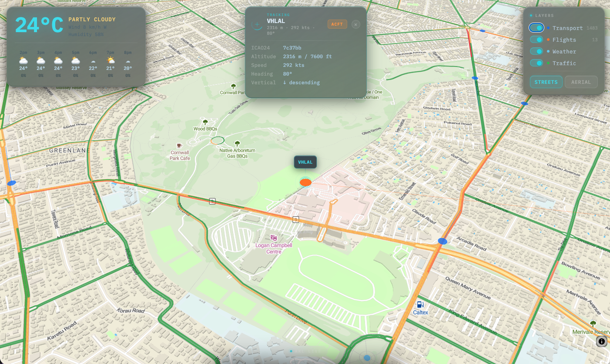
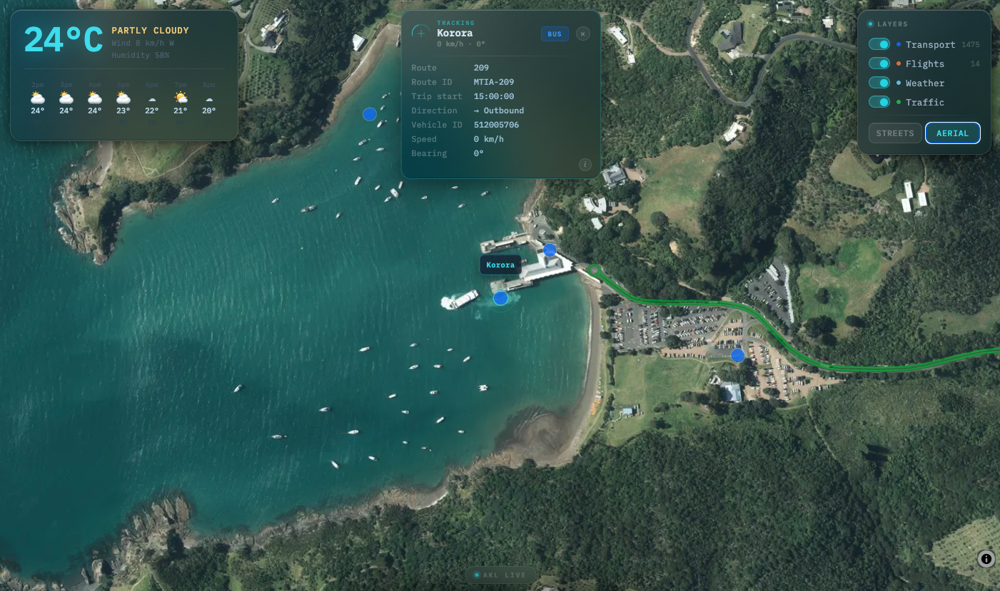

# Auckland Live

Real-time geospatial dashboard for Auckland — public transport, aircraft, and weather rendered over a vector basemap using MapLibre GL JS and deck.gl.




## Running locally

You need two terminals.

**Terminal 1 — API proxy** (handles CORS + injects API keys):
```bash
node proxy.js
```

**Terminal 2 — static file server:**
```bash
npx serve .
```

Then open `http://localhost:3000` (or whatever port `serve` picks).

## Config

Copy the example config and fill in your keys:

```bash
cp config.local.example.js config.local.js
```

```js
// config.local.js
export const CONFIG = {
  MAPTILER_KEY: '...',           // maptiler.com — free tier
  AT_API_KEY: '...',             // dev-portal.at.govt.nz — free
  OPENSKY_CLIENT_ID: '...',      // opensky-network.org — free account
  OPENSKY_CLIENT_SECRET: '...',
  LINZ_API_KEY: '...',           // basemaps.linz.govt.nz — free
  TOMTOM_API_KEY: '...',         // developer.tomtom.com — free tier
};
```

`config.local.js` is gitignored. Never commit it.

## API keys

| API | Where to get it | Cost |
|-----|----------------|------|
| MapTiler | [cloud.maptiler.com](https://cloud.maptiler.com) | Free (100k req/month) |
| Auckland Transport | [dev-portal.at.govt.nz](https://dev-portal.at.govt.nz) | Free |
| OpenSky Network | [opensky-network.org](https://opensky-network.org) | Free (4k credits/day authenticated) |
| LINZ Basemaps | [basemaps.linz.govt.nz](https://basemaps.linz.govt.nz) | Free |
| TomTom | [developer.tomtom.com](https://developer.tomtom.com) | Free (50k tile req/day) |
| Open-Meteo | — | No key needed |

## Architecture

```
Browser (MapLibre + deck.gl)
  ↓
proxy.js :3001              ← local dev only
  ├── /at/*      → api.at.govt.nz          (injects AT key)
  └── /opensky/* → opensky-network.org     (OAuth2 client credentials)

Open-Meteo  → direct from browser (no auth)
LINZ        → direct from browser (key in tile URL, domain-safe)
TomTom      → direct from browser (key in tile URL, domain-safe)
```

The proxy is only needed locally. In production this is replaced by a Cloudflare Worker.

## Stack

- **[MapLibre GL JS v4](https://maplibre.org/)** — vector basemap (MapTiler streets-v2) or LINZ aerial imagery
- **[deck.gl v9](https://deck.gl/)** — WebGL overlay for transport/aircraft layers
- **[TomTom Traffic API](https://developer.tomtom.com/traffic-api/documentation/traffic-flow/raster-flow-tiles)** — real-time flow tiles (MapLibre raster layer)
- **[RainViewer](https://www.rainviewer.com/api.html)** — rain radar tile (free, no key)
- **[Open-Meteo](https://open-meteo.com/)** — weather conditions (free, no key)
- Vanilla JS ES modules, no build step

## Data layers

| Layer | Source | Refresh | Routing |
|-------|--------|---------|---------|
| Public transport | Auckland Transport GTFS-RT | 10s | Via proxy |
| Aircraft | OpenSky Network ADS-B | 10s | Via proxy |
| Traffic flow | TomTom raster tiles | Live (tile cache) | Direct |
| Rain radar | RainViewer | 10 min | Direct |
| Weather HUD | Open-Meteo | 5 min | Direct |
| Aerial imagery | LINZ Basemaps | Static | Direct |

## What's built

- Live transport symbols (blue=transit, orange=inferred rail, teal=inferred ferry) with 2-min fading trails
- Heading-oriented aircraft symbols coloured by altitude (orange shades → green on ground)
- **Vehicle follow mode** — click any dot to lock on: map flies to zoom 15 and tracks the vehicle each poll
  - Tracker HUD slides in at top-centre with estimated speed, observation age, data quality and technical details
  - On-map callout: two staggered pulsing lock-on rings + glass label tag above the vehicle
  - Click empty map or ✕ to release; auto-releases if vehicle drops off the feed
  - AT data quality note (ⓘ, transport only) — explains GPS speed estimates and uncertain vehicle modes
- 24h hourly forecast strip (temperature, conditions, rain probability)
- Rain radar overlay (RainViewer, refreshes every 10 min, linear-filtered for smooth rendering)
- Weather HUD: temperature, conditions, wind, humidity
- Layer toggles (transport, flights, weather, traffic)
- Streets / Aerial basemap toggle (LINZ high-resolution orthophoto)
- Real-time traffic flow overlay (TomTom, green=free flow → red=stopped)
- iOS 26-style liquid glass UI (backdrop-filter, specular highlights, refraction gradients)
- Map constrained to NZ North Island — pan and zoom bounds enforced

## Known data quality issues

- **AT speed data**: Reported speed can spike to implausible values. Displayed speeds now use filtered GPS interval estimates instead; see the estimation rules below.
- **AT vehicle mode**: The current feed parser has no authoritative mode lookup. Recognised rail and ferry route codes are marked as inferred; all other vehicles are labelled Transit.

## What's not built yet

- Cloudflare Worker + Pages deployment
- Authoritative route names, modes, destinations and stop predictions

## October 2026 visual and data-quality update

The dashboard now uses a navy night map, readable glass panels, heading-oriented
symbols, and smooth motion between received observations. Harbour, City centre,
Airport and Region scenes set a composed camera and relevant layers; the optional
tour stops when the user interacts with the map. Narrow screens collapse controls
and the briefing into drawers. Reduced-motion settings disable interpolation and
camera animation.

The **Auckland now** briefing reports recent transit vehicles in the viewport,
GPS-estimated movement, airborne/descending aircraft within the feed's coverage,
and the peak city-centre rain probability over the next six hourly forecast slots.
It does not infer delays, congestion trends, or departures from position data.
Feed fetch ages, radar-frame age and individual observation ages are shown;
stale feeds are identified and old objects become faint.

### Transport speed estimation

Raw GTFS speed readings are retained internally for diagnostics and are not used
for the displayed speed. `js/utils/transport-quality.js` estimates interval-average
speed from great-circle displacement and **vehicle observation timestamps**.

- The first recent position has no speed estimate. Repeated/out-of-order timestamps
  cannot create a new estimate or change the accepted position.
- Displacement within 12 metres is treated as GPS jitter. A recent stop takes
  effect immediately; moving estimates use the median of up to three intervals.
- Estimates require observation intervals of 5–120 seconds and observations no
  more than 120 seconds old (with 10 seconds of clock-skew tolerance).
- Plausibility limits are 140 km/h for unknown transit mode, 162 km/h for inferred
  rail and 90 km/h for inferred ferries. Changes greater than 3.5 m/s² are rejected.
  These are configurable heuristics in the source, not verified physical limits.
- A rejected fix holds the last accepted position and makes speed unavailable;
  the next valid fix can recover against that anchor. Gaps longer than two minutes
  re-anchor the vehicle and require another position before showing speed.

Displayed speeds are labelled **estimated** (`~`), are not instantaneous speeds,
and can understate travel around curves because the estimate uses straight-line
GPS displacement. The 12-metre deadband can understate very slow movement.
Displayed positions interpolate between received points and can lag the latest
observation by up to ten seconds. They are not predicted positions or road-snapped
routes. Unknown vehicle modes are labelled **Transit**, avoiding false bus labels.

The local API proxy binds to `127.0.0.1` and permits only HTTP loopback browser
origins. Start it with `node proxy.js`; serve the frontend with `npx serve .` as
before. The UI pauses polling in hidden tabs, resumes on return, prevents overlapping
requests per feed and times out feed requests after 15 seconds.

Run the speed-filter and motion regression checks with:

```bash
node --test tests/*.test.js
```
